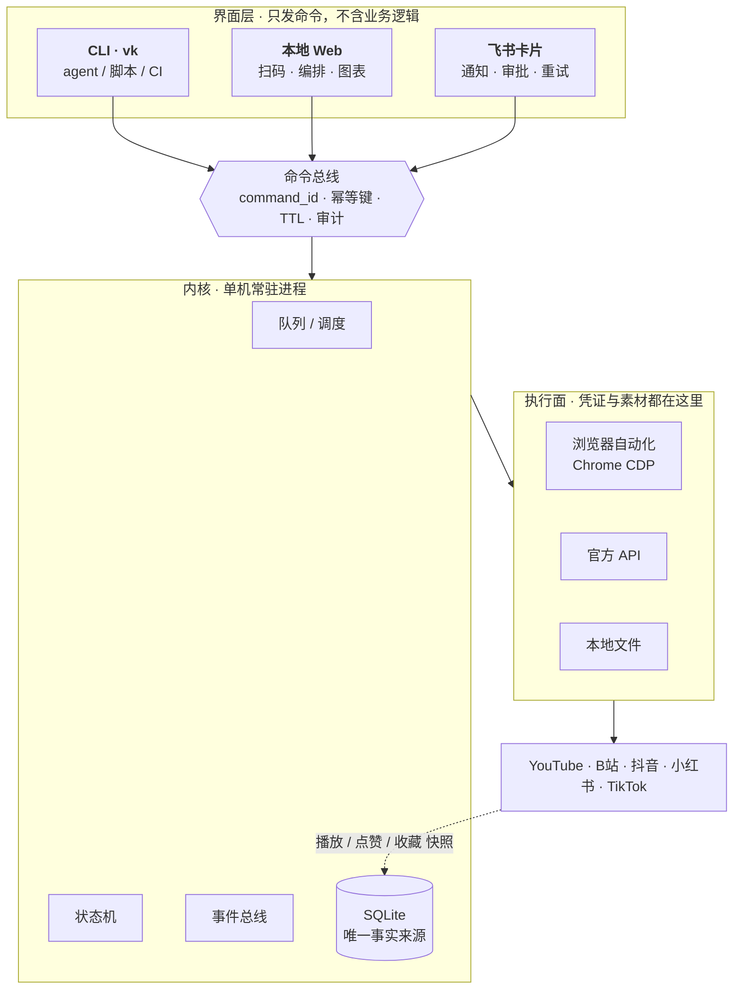
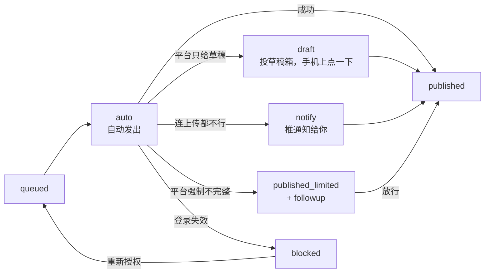
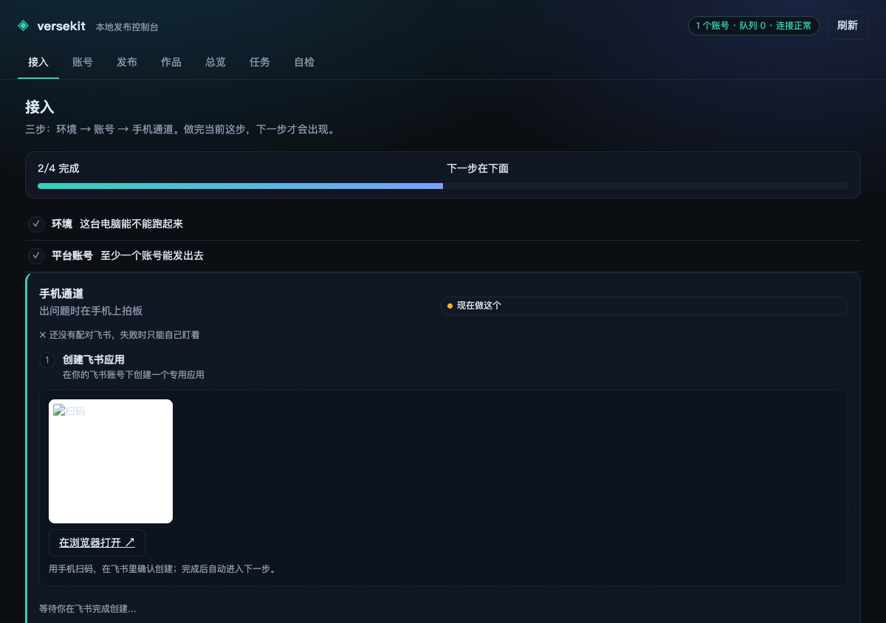

<h1 align="center">versekit</h1>

<p align="center">
  给创作者的开源工具集
</p>

<p align="center">
  跑在你电脑上的<strong>多平台发布 + 自有账号数据</strong>控制面<br/>
  <sub>电脑干活（凭证、发布、采集）· 手机拍板（通知、审批、重试）</sub>
</p>

<p align="center">
  <a href="docs/PRD.md">PRD</a> ·
  <a href="docs/ARCHITECTURE.md">架构</a> ·
  <a href="docs/platforms.md">平台矩阵</a> ·
  <a href="docs/adapter-contract.md">适配器规约</a> ·
  <a href="docs/channels.md">通道</a> ·
  <a href="docs/wireframes.html">设计稿</a>
</p>

---

## 它解决什么

一条内容发 6 个平台要 40 分钟；发完不知道效果；登录态天天过期，人在外面就卡住。

现有产品分两类，两类都缺一半：**SaaS**（Buffer / Postiz Cloud / 蚁小二）手机体验好，但**凭证在别人手里**；**自托管开源**（Mixpost / Postiz 自部署）数据在自己手里，但**没有手机控制面**。

versekit 的位置只有一个：

> **凭证在你手里，同时手机上能拍板。**

---

## 怎么工作



**三条铁律**（进 CI）：CLI 能力完整（没有"只有网页能做"的事）· 三端语义一致 · Web 与飞书不得直接读写数据库。

---

## 发布模式

默认 `auto`，走不通才降级 —— **人只在该被叫醒时被叫醒**。



**永不静默失败**：每次发布必须终结在 `published / published_limited / 草稿待发 / notify待确认 / failed(带原因)` 之一，且记 `fallback_reason`。

---

## 状态

**v0.1 内核闭环 + v0.2 本地控制台（进行中）**：一条内容能通过 Web 或 CLI 发到 B站 / TikTok，
失败会降级、状态会落库、数据会按节奏回收。飞书通道还没接。

<p align="center">
  
  <br/><sub>总览：成功、失败、待处理与账号健康在一屏（真实运行截图）</sub>
</p>

| 层 | 状态 |
|---|---|
| 文档（PRD / 架构 / 平台矩阵 / 适配器规约 / 设计稿） | ✅ |
| 内核（schema · 状态机 · 事件目录 · 租约队列 · 命令注册表） | ✅ |
| 守护进程（unix socket + 本地 HTTP 共用一份 dispatch · 审计） | ✅ |
| Chrome CDP 驱动（每账号 profile/端口 · 真实鼠标 · shadow DOM · 响应拦截） | ✅ |
| CLI（19 条命令，含 publish / account / collect / stats / runs / events） | ✅ |
| **本地 Web 控制台**（接入 / 账号墙 / 发布台 / 作品 / 总览 / 任务 / 自检） | ✅ 真浏览器验收 + SSE 实时刷新 |
| **接入向导**（环境 → 账号 → 通道 → 第一条） | ✅ 只展开当前一步；飞书两次扫码，其余自动推进 |
| 适配器 B站（biliup 发布 + 创作中心采集 + 登录体检） | ✅ 待真机验收 |
| 适配器 TikTok（Studio 发布 + 后台拦截采集 + 登录探测） | ✅ 待真机验收 |
| 手机拍板 | ✅ 两种通道：**签名审批链接**（无需飞书，手机浏览器直接拍板）＋ 飞书卡片按钮 |
| 其余三平台（YouTube / 小红书 / 抖音） | ⬜ v0.3 |
| CI 门禁（parity 19 · adapter-contract 15 · no-backdoor） | ✅ |

## 快速开始

```bash
node -v                     # 需要 ≥ 22.13（node:sqlite；更早的 22.x 有 .get() 返回 null 行的问题）
npm run vk -- init          # 建库 + 配置
npm run vk -- serve         # 启动守护进程，打开 http://127.0.0.1:8787
```

第一次打开如果还没有账号，会自动落在「接入」页：四步走完即可发布，不需要先读文档。

浏览器里就是控制台：加账号 → 拖素材 → 勾平台 → 发布。也可以全部用 CLI：

```bash
npm run vk -- account add bilibili --name 主号 --credential ~/cookies.json
npm run vk -- publish ep1.mp4 --to bilibili --title "第一条" --dry-run
npm run vk -- publish ep1.mp4 --to bilibili --title "第一条"
npm run vk -- now --human
npm run vk -- stats works --range 7d
```

B站需要先 `biliup -u ~/cookies.json login` 选「浏览器登录」；TikTok 在控制台里登录一次即可。
状态目录（`VK_HOME` 可改）：

```
~/.config/versekit/        config.json · credentials/
~/.local/state/versekit/   vk.db · vk.log · browser/<account>/ · assets/ · evidence/
```

## 平台

| 平台 | 路线 | 资质 | 状态 |
|---|---|---|---|
| YouTube | 官方 Data API v3 | 不需要 | 设计完成，待实现 |
| B站 | biliup + 自己的 cookie | 不需要 | ✅ 发布 / 采集 / 体检，待真机验收 |
| TikTok | TikTok Studio 网页自动化 | **不需要** | ✅ 发布 / 采集 / 体检，待真机验收 |
| 小红书 | 创作服务平台网页自动化 | **不需要** | 设计完成，待实现 |
| 抖音 | 创作者中心网页自动化 | **不需要** | Wave 2 |

详见 [`docs/platforms.md`](docs/platforms.md)。

---

## 合规边界

只自动化**你自己已登录的会话**（扫码得到的 cookie / Chrome profile）：不逆向签名、不采集公开内容、不碰别人的账号。

这条边界是开源能站住的前提，也是上表"零资质"的原因 —— 平台授权的是**用户你自己**，不是我们的应用。

---

## 仓库

```
packages/
  core/              schema.sql · 状态机 · 事件 · 队列 · 命令注册表 · test/
  driver-browser/    持久 Chrome CDP 驱动（每账号 profile · 三平台共用）
  adapter-bilibili/  biliup 发布 + 创作中心采集
  adapter-tiktok/    TikTok Studio 自动化 + 后台拦截采集
  web/               本地控制台（零构建，daemon 直接托管）
  cli/               vk
scripts/ci/          parity · adapter-contract · no-backdoor
docs/
  PRD.md             产品定义 · 范围 · 竞品位置 · 路线图
  ARCHITECTURE.md    进程形态 · schema · 命令表 · 事件 · 采集器 · CI 契约
  platforms.md       五平台能力矩阵（自动化 / 资质 / 降级率）
  adapter-contract.md 适配器规约：接口 + 14 条硬规则 + 反模式
  adr-0001-reuse.md  复用裁决：只借知识，少抄代码
  wireframes.html    7 屏设计稿（浏览器打开）
```

---

<p align="center"><sub>MIT · versekit</sub></p>
